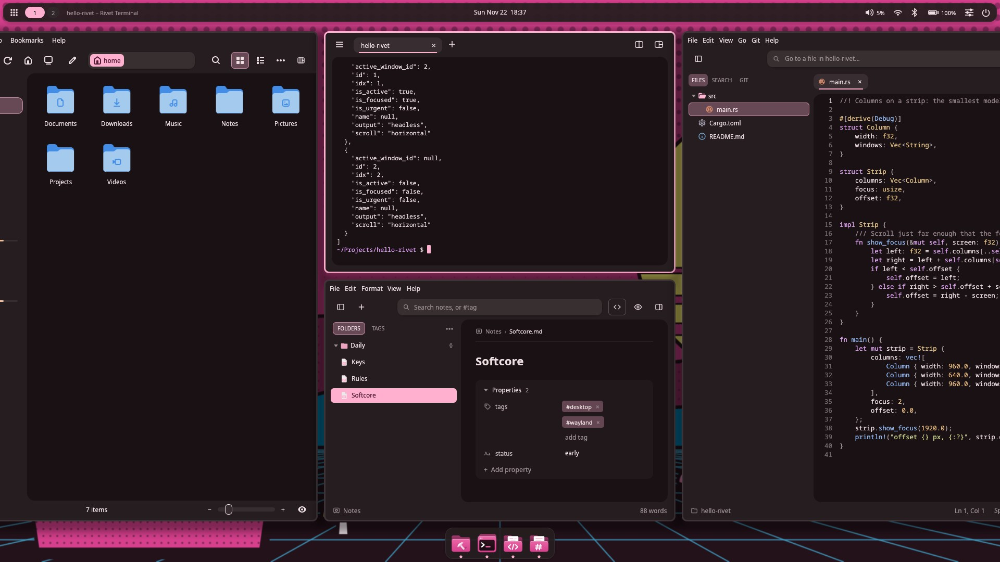
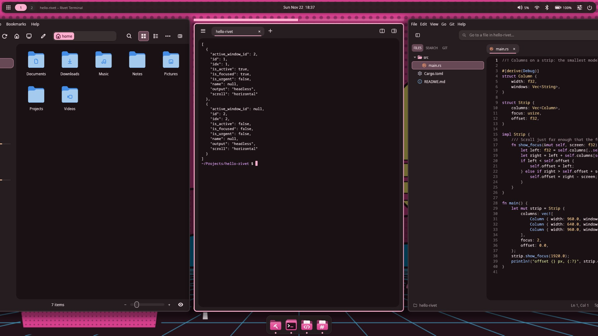
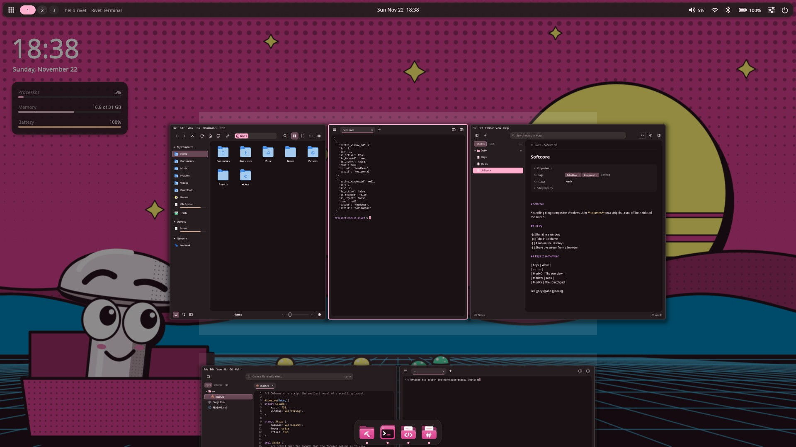
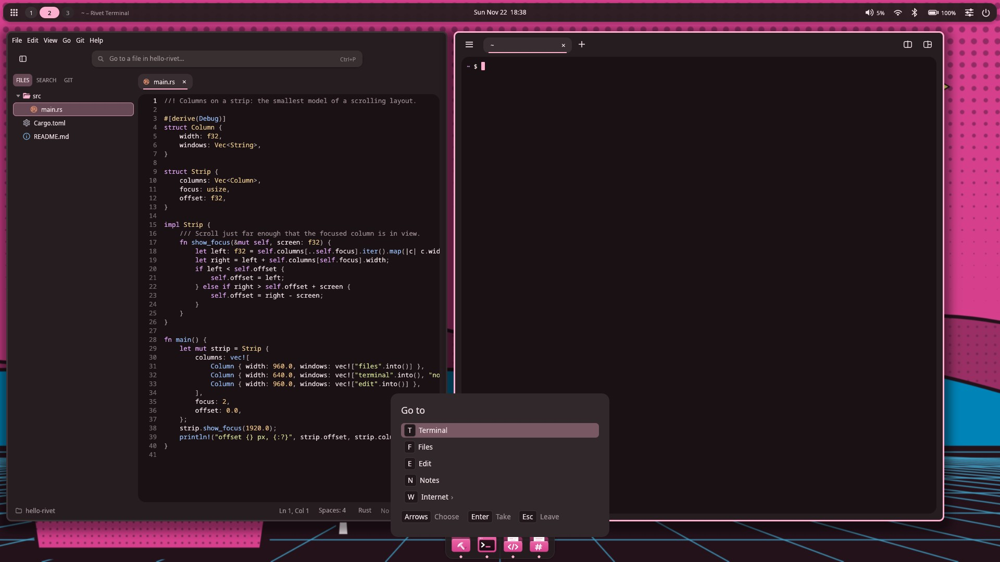
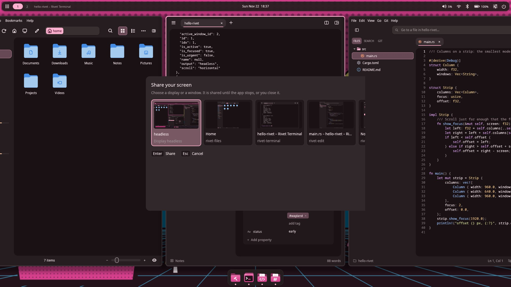
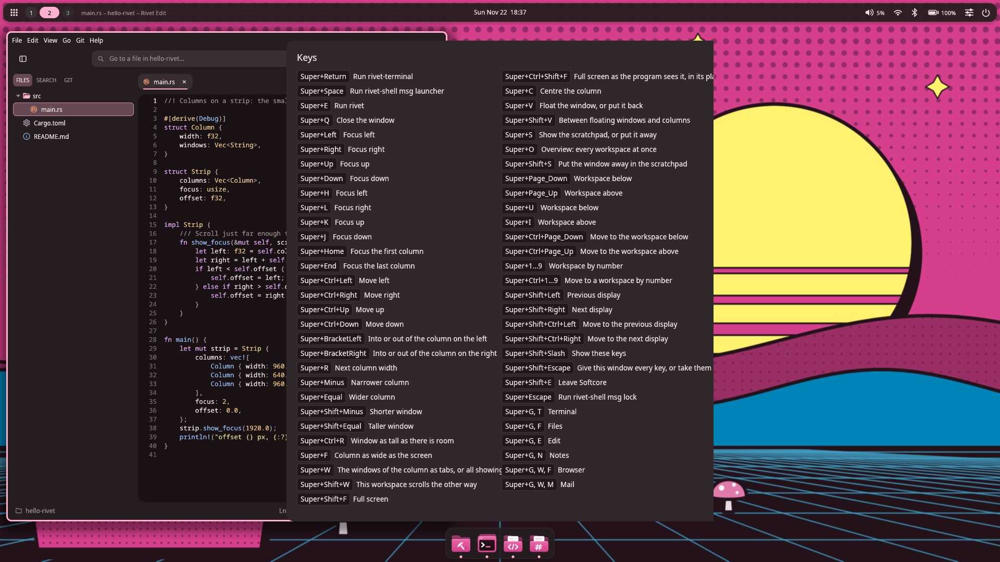
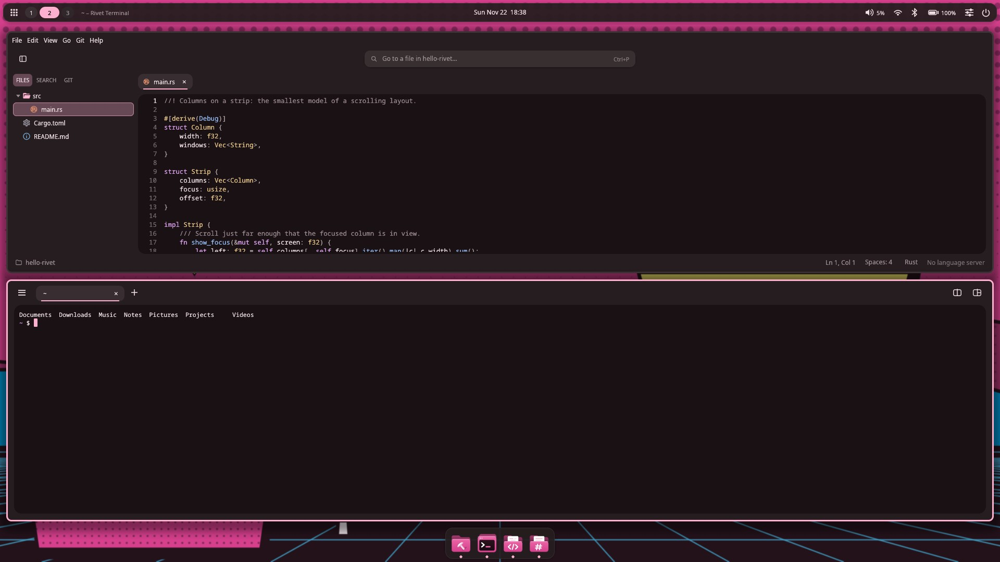

<p>
  
</p>

# Softcore

[](https://github.com/rivetsoft/softcore/actions/workflows/ci.yml)
[](#license)
[](#install)
[](https://github.com/Smithay/smithay)


A scrolling Wayland compositor that feels oh so good. Windows sit in columns on a strip that
runs off both sides of the screen, and you scroll through them: side to side, or up and down.
It is the compositor of the [Rivet desktop](https://github.com/rivetsoft/apps), written in
Rust on [Smithay](https://github.com/Smithay/smithay).

The website and the docs are at [rivetsoft.github.io](https://rivetsoft.github.io/).



Softcore works the way [niri](https://github.com/YaLTeR/niri) does, and is written from
scratch: if you know niri's actions and `niri msg`, you already know Softcore's.
**Early:** its releases are pre-releases.

## What it does

### Zip across the plane

- **A strip per workspace.** Open as many windows as you like; none of them shrinks the
  others. Columns can hold several windows, and be any width.
- **Workspaces per display,** with an empty one always last. Unplug a display and its
  workspaces move to another, then go back when it returns.
- **Tabs, floats and scratchpads.** A column can show its windows as tabs; any window can
  float; scratchpads with names come and go on a key.
- **Up and down too.** A workspace can scroll vertically, which suits a tall display.



### See it all at a glance

The overview draws every workspace of each display at once, at half size. Click a window or
a workspace to go there; the bindings all go on working while it is open.



### Push all the right buttons

- **Bind anything to anything,** in one settings file of plain `key=value` lines. Save it and
  Softcore reads it again.
- **Chords:** one key, then another. A panel shows what can come next, and H, J, K and L work
  in it.
- **A panel of every binding,** for the one you forgot.
- **Rules:** tell any window where to go, whether to float, and how see-through to be.



### Put on a show

- **Screen sharing is built in.** Every display and window gets a card with a live preview;
  share a window and the stream stays with it, even off screen.
- **Screenshots too.** Print or Mod+S, then drag out an area, click a window or take the lot.
  It is saved and put on the clipboard, and E opens it in
  [Rivet Snip](https://github.com/rivetsoft/apps/tree/main/apps/rivet-snip) to mark up.



### More

| | |
| --- | --- |
|  |  |
| **Every binding**, on one panel. | **Up and down**: rows one under the other. |

Also: blur behind see-through windows and panels, shadows, animations, touchpad gestures,
X11 programs through Xwayland, a lock screen protocol, and `softcore msg` with an event stream
for scripts and shells.

## Made for Rivet

Softcore and [Rivet Shell](https://github.com/rivetsoft/apps/tree/main/apps/rivet-shell) were
made for each other, and each works without the other.

- **Dressed to match.** Borders and Softcore's own panels wear the desktop's colors, and
  change when the desktop does.
- **Rivet Shell on top.** Its panels, dock and launcher know Softcore's workspaces, window
  titles and displays, and its Settings has a page for Softcore.
- **Shared pieces.** Anything Softcore draws itself goes through the Rivet apps' own crates
  (`rivet-look`, `rivet-kit`, `rivet-xdg`).
- **Any other shell works.** Panels, docks and launchers that use the layer-shell protocol
  run under Softcore as they do under niri or Sway.

## Install

Download `softcore-VERSION-x86_64-linux.tar.gz` from the
[releases](https://github.com/rivetsoft/softcore/releases), then:

```sh
tar xzf softcore-VERSION-x86_64-linux.tar.gz
cd softcore-VERSION-x86_64-linux
./install.sh               # asks for your password, then installs Softcore
./install.sh --uninstall   # takes it all away again
```

That installs it for everyone on the machine, and puts it in your login manager's list of
sessions from the next time you log out. It needs glibc 2.35 or newer (Ubuntu 22.04, Debian 12)
and the libraries a Wayland desktop usually has: libseat, libinput, libgbm, EGL, libxkbcommon
and PipeWire.

To build it from source instead, you need Rust 1.88 or newer and the same libraries with their
headers, and libdisplay-info:

```sh
git clone https://github.com/rivetsoft/softcore.git
cd softcore
./install.sh               # builds Softcore, then asks for your password to install it
```

To try it without installing anything:

```sh
cargo build --release
./target/release/softcore              # from a desktop: opens in a window. From a TTY: takes the displays.
./target/release/softcore --headless   # a display in memory, for checks and screenshots
```

Mod is Super on displays of its own, and Alt in a window. Mod+Return opens a terminal,
Mod+Shift+Slash shows every binding, and Mod+Shift+E leaves.

> **About "early".** Softcore is used on its author's machine and nowhere else yet. Other
> hardware (more than one GPU, touchpads, touchscreens, tablets) is written and untried.
> The manual has the [honest list](docs/manual.md#what-isnt-built-yet).

## Learn more

- [The manual](docs/manual.md): settings, bindings, rules, displays, screen sharing,
  `softcore msg` and what isn't built yet
- [What changed](CHANGELOG.md) in each release, and [how a release is made](docs/releasing.md)
- [Softcore on the website](https://rivetsoft.github.io/softcore/), and its
  [docs](https://rivetsoft.github.io/docs/softcore/)
- [Rivet Shell and the Rivet apps](https://github.com/rivetsoft/apps)

## License

[MIT](LICENSE-MIT) or [Apache-2.0](LICENSE-APACHE), at your option.

Softcore is built on [Smithay](https://github.com/Smithay/smithay) (MIT). It follows
[niri](https://github.com/YaLTeR/niri)'s behaviour and uses none of its code.
The wallpaper in the pictures is Rivet at dusk, from the Rivet website.
